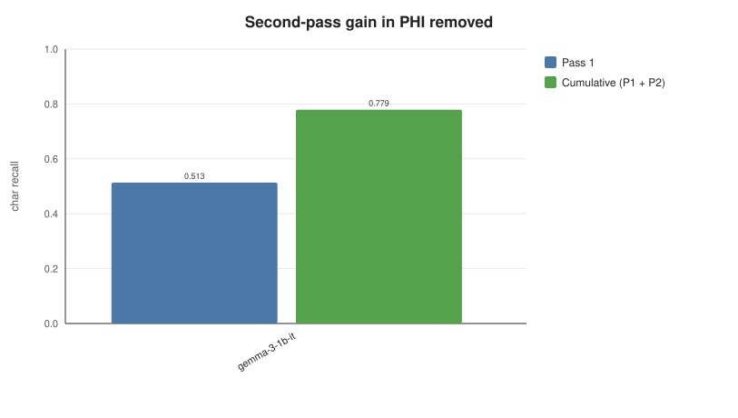
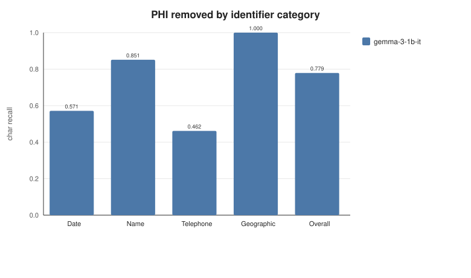
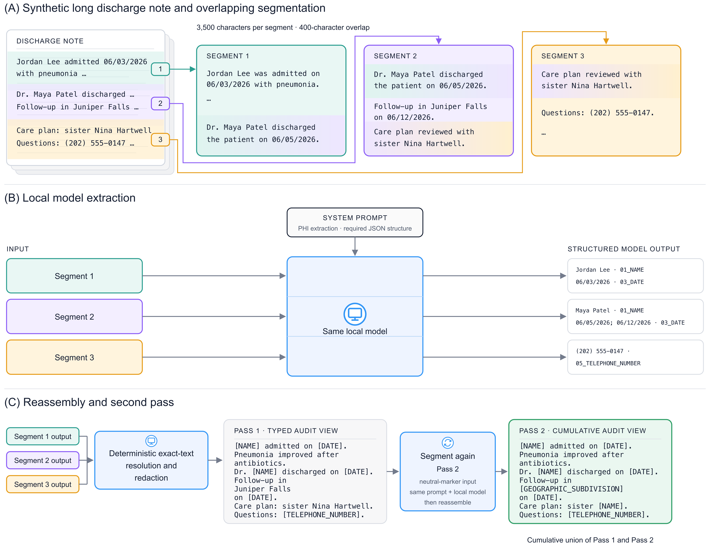

# Analysis scripts

The table, figure, and interval scripts read scorer outputs. The agreement,
comparator, and timing sections identify their separate inputs. All examples
must use synthetic or institutionally approved inputs. The public examples do
not reproduce the manuscript's numerical results.

## Tables

```bash
# Reference-corpus counts from the supplied annotations
python3 scripts/make_corpus_table.py --gold-dir fixtures/synthetic/gold

# Recorded checkpoint metadata
python3 scripts/make_checkpoints_table.py

# Scorer-derived result fields for one execution
python3 scripts/make_results_table.py --metrics out/metrics_long.csv
```

The corpus script summarizes the annotations supplied to it; it cannot reconstruct
the study's source-corpus selection funnel from the synthetic notes. The
checkpoint table uses the committed model metadata. The results table ranks the
supplied models by cumulative character recall. The ranking is descriptive of
those inputs, not a general model recommendation.

The manuscript reports means over three separate stability executions. For
matched outputs, repeat `--metrics`:

```bash
python3 scripts/make_results_table.py \
    --metrics run1/metrics_long.csv \
    --metrics run2/metrics_long.csv \
    --metrics run3/metrics_long.csv
```

The helper matches row keys, reference-set fingerprints, denominators, and model
metadata before averaging numeric outcomes. Comparisons reject different
reference sets or cohorts rather than silently comparing different notes.
These are separate executions of the same notes, not additional independent
notes. Processing-time aggregation uses the separate helper below; the result
table does not invent missing times or confidence limits.

## Character-metric confidence intervals

```bash
python3 scripts/bootstrap_ci.py --per-doc out/per_doc_long.csv
```

With three synthetic notes, this is only an execution example. For the
manuscript's three-execution preparation, supply all three matched per-note files:

```bash
python3 scripts/bootstrap_ci.py \
    --per-doc run1/per_doc_long.csv \
    --per-doc run2/per_doc_long.csv \
    --per-doc run3/per_doc_long.csv
```

The script checks matching model/pass/note keys, source and annotation hashes,
reference-set fingerprints, and invariant reference counts,
averages stored character counts by note across executions, then resamples notes
with replacement. The manuscript's character-recall procedure uses 10,000
resamples, seed `20260801`, and the 2.5th and 97.5th percentiles. Intervals reflect
note-sampling variability, not model-run variability. Applying this procedure to
the synthetic fixture demonstrates the calculation; it does not reproduce a
clinical confidence interval.

Character recall is the default interval. To calculate the separate Presidio
character precision, recall, and F1 intervals from compatible single-run
per-note counts, select those metrics and its stated bootstrap seed explicitly:

```bash
python3 scripts/bootstrap_ci.py --per-doc presidio/per_doc_long.csv \
    --character-metrics recall precision f1 --seed 20260721
```

Precision and F1 require per-note false-positive counts. Their interval columns
are emitted only when requested; no unavailable counts are inferred. These
intervals accept one execution, matching the manuscript's Presidio analysis.
Multi-execution intervals support recall only. In general, precision or F1 from
averaged counts differs from the mean of the individual-execution values, so
the helper rejects that unsupported combination rather than silently changing
the reported statistic.

The current manuscript reports note-level completeness descriptively as a mean
count across executions, rounded to the nearest whole note. It does not report
completeness confidence intervals. Do not reinterpret a rounded mean as the
number of notes complete in every execution, or infer the individual execution
counts from that mean.

## Figures

```bash
python3 scripts/make_figures.py \
    --metrics run1/metrics_long.csv \
    --metrics run2/metrics_long.csv \
    --metrics run3/metrics_long.csv \
    --out-dir out/figures
```

One `--metrics` argument is also accepted for a single execution. Each figure is
written as SVG plus a CSV of its plotted values. These are repository-specific
renders of the analyses associated with manuscript Figures 2–6, not copies of
the submitted figure images. They use the cumulative two-pass, all-expected-note
view, with Pass 1 added where required by the comparison.

| Output | Analysis |
| --- | --- |
| `figure2` | Character recall and note-level completeness. |
| `figure3` | Character recall versus the proportion of redacted characters outside reference spans. |
| `figure4` | Any/full span coverage and relaxed/strict boundary agreement. |
| `figure5` | Pass 1 versus cumulative Pass 2 character recall. |
| `figure6` | Category-specific recall and pooled overall recall. |

Previously generated illustrations under [images/figures](images/figures) show
Gemma 3 1B on the three-note synthetic fixture, not the 17-model clinical study.
Their stored second-pass example has recall 0.513 before and 0.779 after Pass 2;
these values are an illustration, not an expected result for every new model run.





The methods schematics are separate, fixed images. Supplementary Figure S1
illustrates segmentation, extraction, and reassembly:



## Independent-annotation agreement

```bash
PYTHONPATH=src python3 -m deid.agreement \
    --annotator-1 /approved/independent-1 \
    --annotator-2 /approved/independent-2 \
    --expected-notes 130 --out /approved/analysis/agreement.json
```

Both directories must contain the same document IDs and identical source text
per note, in the validated PubAnnotation format. The optional expected-note
guard checks the supplied cohort size; it does not create missing notes.
Character and whitespace-token F1/Dice and Cohen's kappa are pooled over that
cohort. A token is positive if any of its characters overlaps an annotation.
Entity matches are type-agnostic and one-to-one: exact pairs first, then pairs
with the greatest overlap. This human-agreement rule differs from the scorer's
non-exclusive, two-character endpoint tolerance for model predictions.

The output contains aggregate counts and metrics, not note text or identifier
strings. Comparing consensus copies with themselves is a software check, not
evidence of independent annotation agreement. This is a new companion
implementation of the described method, not the original agreement script.

## Optional Presidio comparator

Use a separate environment with the comparator dependencies and the exact spaCy
language model installed before running:

```bash
python3 -m pip install -r requirements-comparator.txt
python3 -m pip install \
    https://github.com/explosion/spacy-models/releases/download/en_core_web_lg-3.8.0/en_core_web_lg-3.8.0-py3-none-any.whl

PYTHONPATH=src python3 -m deid.presidio_runner \
    --notes-dir fixtures/synthetic/notes --out-dir out/presidio/predictions
PYTHONPATH=src python3 -m deid.metrics \
    --pred-dir out/presidio/predictions --gold-dir fixtures/synthetic/gold \
    --out-dir out/presidio
```

The comparator checks Presidio Analyzer `2.2.364`, spaCy `3.8.14`, language model
`3.8.0`, and the 17 default recognizers. The manuscript reports Python `3.12.13`
for its original comparator environment. The command adds no recognizers,
allowlist, explicit threshold, or retries and performs no automatic download.
It uses the same 3,500/400 character windows, redacts Pass 1, resegments, and
unions the mapped detections from both passes. It uses detected offsets rather
than the LLM's document-wide literal-propagation rule.

Saved predictions use the explicit type `UNSPECIFIED`, representing an untyped
comparator mask. They support type-agnostic accuracy and gold-category recall,
not a claim that Presidio assigned the study's 18 categories. Comparator
provenance and full-pipeline note timings are saved separately; LLM finish-reason
or JSON-format records are not invented for it. This new companion runner is
not the original comparator script and has not rerun the reported baseline.

## Processing time

```bash
python3 scripts/summarize_timing.py \
    --pred-dir run1/predictions --pred-dir run2/predictions \
    --pred-dir run3/predictions --out out/timing.csv
```

For each LLM execution, the helper sums recorded segment request latencies
across both passes for each note, then takes the median across notes. It reports
the mean of those medians across matched executions. It requires the complete
planned note set and every expected request's recorded, finite latency;
missing coverage or durations are errors, not zero times. A failed request's
recorded duration still contributes to processing time.

For Presidio, supply its single prediction root. Its separately recorded
full-pipeline note time includes segmentation, detection, mapping, and redaction,
excluding dependency/model loading and artifact writes. It is labeled separately
from LLM request time. The default offline stub does not record request latencies,
so the timing helper rejects those unknown durations rather than reporting zero.
Any compatible recorded stub timing is labeled synthetic and cannot measure LLM
inference. This helper is new companion analysis code; it cannot
recover unavailable study timing records.

## Scope

The [manuscript map](MANUSCRIPT_MAP.md) identifies implemented methods and their
boundaries. `make all` runs the offline fixture, tables, intervals, charts, and
tests; it does not reproduce the clinical study simply because all commands
finish successfully. The optional comparator and independent-annotation
analysis need their own compatible inputs and are not clinical experiments
performed by the default synthetic example.
